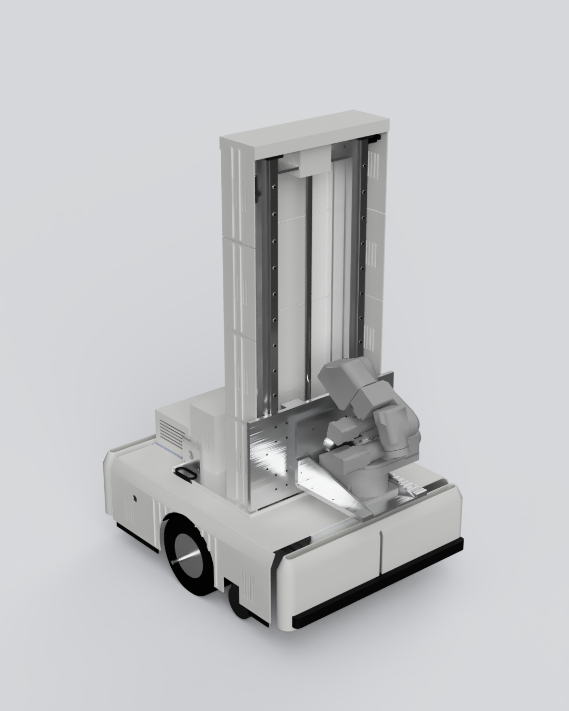
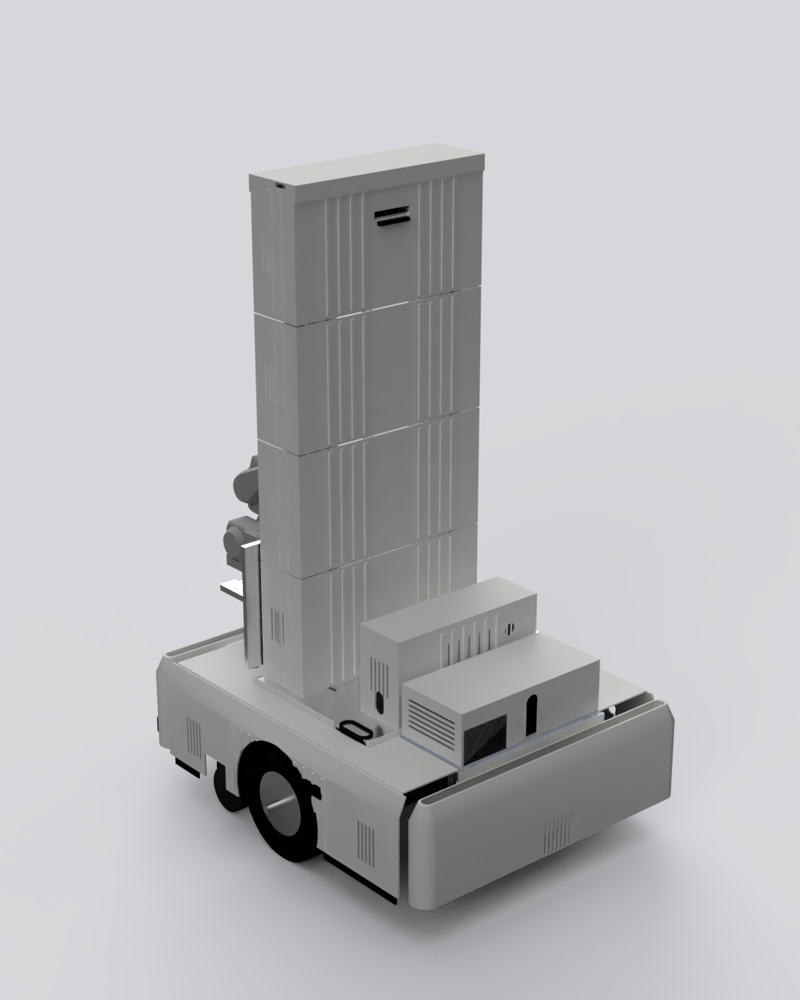
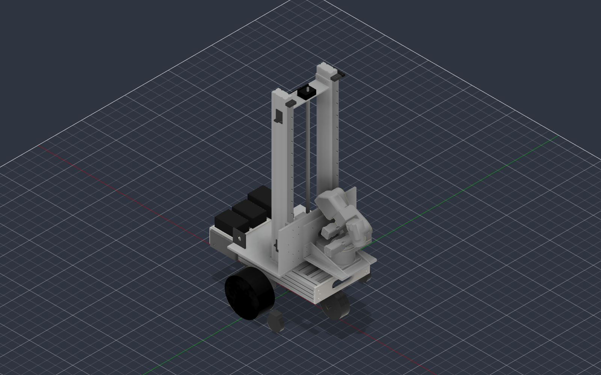
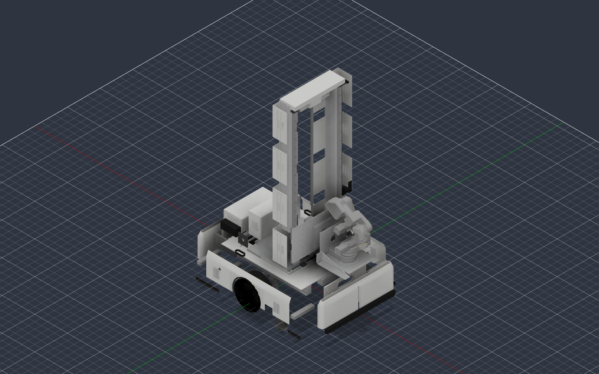
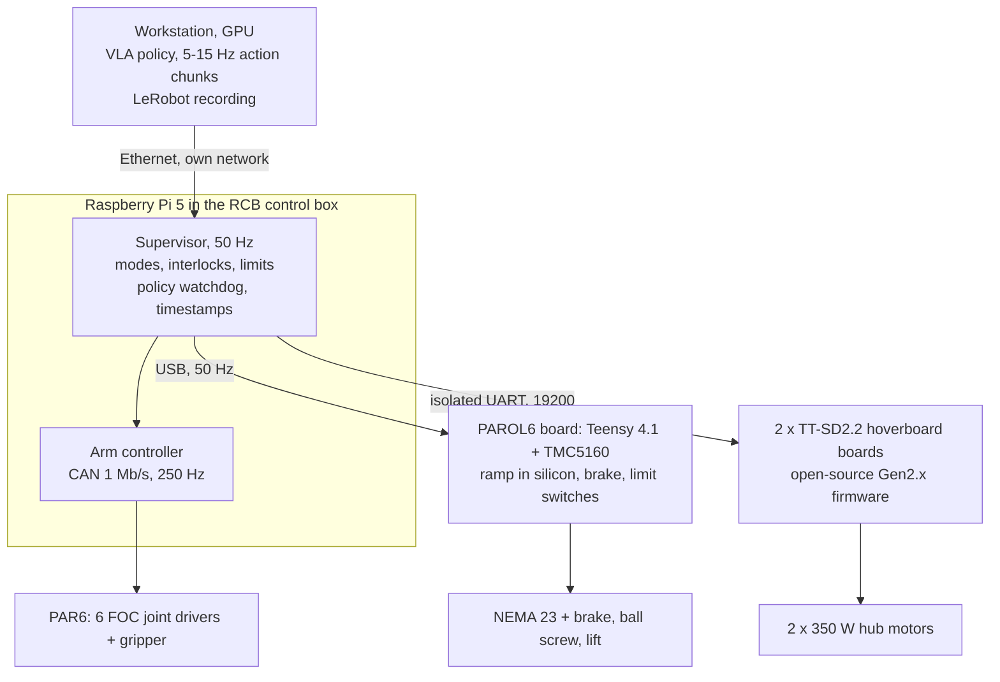
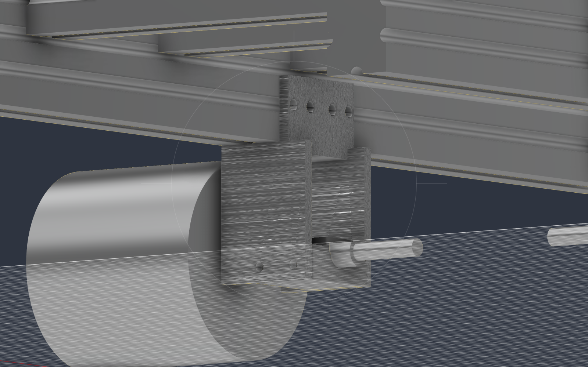

# PAR6 Mobile Platform

A driving base with a 574 mm vertical lift that takes a six-axis arm to the task.
Designed around the [PAR6](https://github.com/Source-Robotics/PAR6-Collaborative-Robot-Arm)
cobot, and modular enough to carry other arms.

> **Status, November 2026:** the design is complete and checked by its own test
> suites. The drive electronics and the lift motor run on the bench. The first
> sheet-metal order is next. Nothing here is a production release yet.

<p align="center">
  
  
</p>

## Why

On a desk, an arm can only reach what is on that desk. PAR6 already runs a
learned policy there: a fine-tuned SmolVLA model puts a bracket into a bowl in
15 of 20 trials, 12 of them on the first attempt. The next limit is reach, not
intelligence. To do tasks around a
home, the arm has to come to them:

- through a 700 mm door,
- from floor level up to counter height,
- and stay upright while the arm works at full reach.

The platform is built for that, and for collecting robot-learning data on the
way. The control interface was designed around the dataset from the start.

## At a glance

These numbers come from the model, not from a spreadsheet:
`bash mobile_base/mass_report.sh` and `python control/dynamics.py`. A range
means the part has not been weighed yet.

| | |
|---|---|
| Footprint | 600 × 560 mm, which leaves 70 mm on each side of a 700 mm door |
| Deck / ground clearance | 240 mm / 45 mm |
| Drive | 2 × 350 W hoverboard hub motors (Ø200 mm), differential drive, 460 mm track, axle under the centre of mass |
| Supports | front omni wheel Ø127, rear compliant caster Ø125, two side anti-tip wheels 8 mm above the floor |
| Frame | 40×80 and 40×40 aluminium profiles, bent sheet-metal brackets, printed covers |
| Lift | 574 mm stroke: SFU1605 ball screw, 2 × HGR20 rails, NEMA 23 with an integrated brake |
| Arm mount | mounting face 307 to 881 mm above the floor; PAR6 reaches 424 mm from that face |
| Battery | 36 V 10S, 460 Wh; about 31 W on average (estimate), so about 12 h |
| Mass | 52.5 to 58.2 kg without the arm |
| Static stability | 112 mm margin to the front, 108 mm to the side; 100 mm required: **pass** |
| Tipping | sideways at 0.28 g (the limiting case), forwards at 0.42 g; motion is capped at 0.14 g |
| Braking | the tyres slip at 0.22 g, well before the 0.42 g forward tipping point |
| Thresholds | 20 mm, with the arm extended |
| Lift column | first mode about 27.5 Hz (FE model, including the arm's lever) |

## The design

<p align="center">
  
  
</p>

- **Base.** Two hub motors sit on one axle under the centre of mass, so they
  carry most of the weight. An omni wheel supports the front, a compliant caster
  the rear. Two anti-tip wheels ride 8 mm above the floor at the sides and touch
  only when the robot leans. The battery sits above the drive axles, clear of the
  lift's motor.
- **Lift.** A ball screw and two linear rails on a spine of two V-slot profiles.
  The motor's brake holds the load with power off, so a power failure leaves the
  arm where it was.
- **Arm.** PAR6 sits on a bent sheet-metal bracket on the lift carriage, with
  J1 vertical, as on a desk. The bracket is the only arm-specific part, which
  makes the platform modular.

## Decisions worth reading

### 1. Three support layouts, chosen by stated priorities

Every layout kept two central drive wheels. The three options were:

- **A:** two casters on the centre line.
- **B:** four corner casters.
- **C:** two casters plus two anti-tip wheels.

The priorities, in order, were traction on both drive wheels, small bumps,
stability of a tall column, cost, and looks.

A won the first two. With the centre of mass near the drive axle, the drive
wheels carry most of the weight. The diamond-shaped support also settles back
onto both drive wheels by itself. A's weak side, lateral stability, was fixed
with C's anti-tip wheels, mounted at the sides instead.

B was rejected because its four rigid corners can lift the drive wheels off a
convex floor.

### 2. A swivel caster is not where you draw it

For six weeks, every stability model placed the front caster's wheel at
X = 240 mm. But a swivel caster's wheel trails its pivot, so after driving
forwards it sits at X = 170. That changed three results:

| | Assumed | Real |
|---|---|---|
| Stability margin | 103 mm (pass) | 58 mm (fail) |
| Braking limit | 0.19 g | 0.12 g |
| 20 mm threshold with the arm extended | passes | fails |

The fix was a front omni wheel, whose contact point does not move. The margin is
now 112 / 108 mm, a pass. Every support that can swivel is now modelled as a disk
of possible contact points, not as a single point.

### 3. Thresholds are a friction problem, not a torque problem

To roll over a step of height *h*, a wheel of radius *R* needs a horizontal push
of *F/W* = tan(acos((*R* − *h*) / *R*)) times its load. The front wheel sets the
limit, not the drive wheels:

- pushing the Ø127 omni wheel over 20 mm takes about 217 N;
- the drive delivers about 267 N before the tyres slip (μ = 0.7).

A stronger motor would not help, because traction is the limit. What helps is
more weight on the drive wheels: the axle sits under the centre of mass, plus
2.3 kg of ballast. A 35 mm step stays out of reach: it would take 406 N.

### 4. The column's spine: two profiles instead of a plate

The first column used a 10 mm plate and two 40 × 50 mm solid bars: 18.7 kg, and
40 tapped holes in solid bar that nothing at hand could drill.

Two 40 × 80 V-slot profiles on edge replaced them:

- 17.7 kg lighter;
- the rails sit on T-nuts, with no drilling at all.

The profiles stand on edge, not flat. Laid flat, the column would be too soft
for the arm's accelerations.

### 5. Removing mass can make a robot less stable

Lightening the column improved the stability margin, because the column sits in
front of the centre of mass. Removing the column's mounting plate made the margin
worse, because that plate sat behind it.

The direction of a change depends on which side of the centre of mass the
removed mass was. That is a general rule, not a one-off.

## Control architecture



**Where code lives.** Whatever must keep working when Wi-Fi drops lives on the
Pi. The rest may live on the workstation.

**Each layer stops its own hardware** when the layer above goes quiet:

- the joint drivers watch their CAN stream;
- the wheel boards stop when their command stream stops (how fast is still to
  be measured);
- the lift gets a host heartbeat. The bench firmware does not have it yet, and
  it is the first change before the lift goes into the robot.

So a frozen policy stops the robot without anyone noticing it froze.

**One gateway.** The supervisor is the only thing that talks to the hardware and
the only place allowed to say "no". The policy proposes; the supervisor permits.
The robot is always in exactly one mode:

| Mode | Allowed | Not allowed |
|---|---|---|
| `MANIPULATE` | arm, gripper, lift | base (its command is forced to 0) |
| `DRIVE` | base, up to 0.14 g | arm outside its transport envelope, lift above driving height |
| `TRANSITION` | supervisor script: fold the arm, lower the lift | the policy, at all |
| `ESTOP` | nothing | leaving, except by an explicit command after the button is released |

Driving and manipulating are separate on purpose. Tipping sideways starts at
0.28 g, and swinging the arm 90° in half a second alone produces 0.13 g.
Separate modes remove that sum, instead of trying to teach a policy to avoid it.

**Dataset-first interface.** The action is always 10 numbers, in every mode:

- 6 arm joint targets;
- the gripper;
- the lift height;
- the base's linear and angular velocity.

Unused slots are recorded as zero, so LeRobot episodes never change shape.
Everything is timestamped on the Pi's clock at capture.

**E-stop chain.** The control box's E-stop input only informs the software, so
power is cut separately. The button carries four normally-closed contacts:

| Contact | Goes to | Effect | Time |
|---|---|---|---|
| NC1 | control box E-stop input | the arm stops; the supervisor knows | ms |
| NC2 | 36 V contactor of the drive | wheels unpowered (stop category 0) | ~20 ms |
| NC3 | Teensy E-stop pin | the lift stops, the brake clamps, the coils still hold | < 1 ms |
| NC4 | 24 V relay of the lift, through a ~250 ms off-delay | driver and brake power is always cut, but after the sequence | 250 ms |

The lift is stop category 1 on purpose. Cutting its power instantly does not
brake it: the brake needs about 120 ms to engage, and the axis would slide
11 to 15 mm (`python control/z_drive.py`).

## Bench work so far

**Wheel drive.**

- The hoverboard's two TT-SD2.2 boards (GD32F130C8T6) were identified, and the
  PC port was found by reading their USART baud registers over SWD. An earlier
  guess from photos had it wrong.
- Both boards were unlocked and flashed with the open-source
  [Gen2.x firmware](https://github.com/RoboDurden/Hoverboard-Firmware-Hack-Gen2.x).
- A Python console with its own frame codec and CRC (`test_rig/hover_console.py`)
  drives a wheel from a PC: 222 frames, 0 rejected.
- Still open: the second wheel, and how fast the wheels stop when commands stop.

**Lift motor.**

- A NEMA 23 with an integrated brake runs on the PAROL6 control board
  (Teensy 4.1, TMC5160), with bench firmware in `test_rig/nema23_bench`.
- Start sequence: release the brake, wait 120 ms, then step. On E-stop: clamp
  the brake, wait 120 ms, then turn the coils off.
- Found on the bench: the TMC5160 loses its configuration if it is sent before
  the 24 V rail is up, so the firmware now waits for the rail.

**Printed fit gauges instead of a caliper.**

- One-to-one prints of the hole patterns (`test_rig/coupons.scad`) confirmed the
  PAR6 base, NEMA 23, HGH20 and BK12/BF12 interfaces.
- They also caught the ball-nut flange. Its holes are at
  0/45/135/180/225/315°, not every 60°, so four holes would have missed by about
  4.7 mm. The model was fixed before any metal was cut.

<p align="center">
  
</p>

## How the model checks itself

The whole design is code: parametric OpenSCAD for the geometry, Python for
loads and dynamics. Every number in this README is printed by a script,
and the scripts check each other:

```bash
bash   mobile_base/mass_report.sh     # mass, centre of mass, stability verdict
python control/dynamics.py            # braking, cornering, arm swing, thresholds (quasi-static)
python control/z_drive.py             # lift speed, torque, brake, E-stop slide
python control/load_paths.py          # rails, beams, plates, screw, arm adapter
python control/check_interface.py     # the lift and the chassis agree, both directions
python z_lift/backbone_stiffness.py   # column section, first mode
bash   mobile_base/check_covers.sh    # covers vs keep-out zones and each other
cd z_lift && bash check_collisions.sh # collisions inside the lift
python test_rig/hover_console.py --selftest   # wheel-board frame codec, CRC, resync
```

Most of the rules behind these checks came from a check that passed when it
should not have:

- **Empty geometry is a silent pass.** OpenSCAD resolves an undefined variable to
  `undef`, so the shape is empty, the collision is empty, and the test reports a
  pass. Seven tests passed this way after a refactor deleted a variable they
  used. A pass now needs four conditions, including a clean log.
- **A test that is not in its runner proves nothing.** When two forgotten tests
  finally ran, one failed at once. Every new test now goes into the runner in
  the same change, with a negative control: rerun it with the old values and
  confirm it fails.
- **A number copied into a second script is a second model.** Copies now assert
  against their source.
- **Every mount needs two pairings:** with what it bolts to, and with what it
  holds. A drive-wheel bracket once sat 75 mm behind its axle and passed straight
  through a beam, with every suite green.
- **A part that must be one piece is a test too.** Counting connected bodies found
  plates cut in two by their own slots, and 12 cover bosses floating in mid-air.

## Timeline

| When | What |
|---|---|
| 2026-08 | First parametric layout. OpenSCAD model, three support layouts, mass budget. Column spine moved from plate to profiles |
| 2026-09 | Control architecture v2. Hoverboard boards flashed, a wheel driven from a PC. Lift motor and brake running on the bench |
| 2026-10 | Caster finding, so a front omni wheel. Printed fit gauges, ball-nut flange corrected. Lift parts measured against the model; appearance approved |
| next | Last measurements, then the sheet-metal order and assembly |

## Repository layout

```
mobile_base/   chassis, covers, mass budget, stability (OpenSCAD + Python)
z_lift/        the lift: column, carriage, collision suite
control/       dynamics, lift drive, load paths, I/O budget, interface check
par6_ref/      PAR6 bracket and its stiffness check (arm meshes not included)
test_rig/      bench tools: hoverboard console, lift firmware and console, fit gauges
viz/           OpenSCAD -> meshes -> Fusion 360 scene for the renders
```

Some comments, and the reports the analysis scripts print, are still in Polish.

## Running it

- OpenSCAD 2021.01 or newer. On Windows, the scripts fall back to
  `C:\Program Files\OpenSCAD`.
- Python 3.10+ with `numpy` and `matplotlib`. The bench consoles also need
  `pyserial`, and `viz/` needs `trimesh`.
- bash (Git Bash on Windows).

The PAR6 arm meshes are not included, because they are under CERN-OHL-S-2.0
(Source Robotics). To draw the arm, copy the seven STL files from
`PAR6 Description/URDF/par6_flange/meshes/` in the
[PAR6 repository](https://github.com/Source-Robotics/PAR6-Collaborative-Robot-Arm)
into `par6_ref/meshes/`. The checks above do not need them; `viz/export.py` does.

## Roadmap

1. Close the last measurements, then place one order of sheet-metal parts.
2. Assemble the frame and the column, then tap-test the column's first mode.
3. Electronics bench on the Pi: add the host heartbeat to the lift firmware,
   measure the wheel boards' timeout, and isolate their UART.
4. Build the supervisor, with teleoperation through it, never around it. That
   way the data matches the robot the policy will drive.
5. Record and train on a standing base first. Then add the lift to the action,
   and only then driving.

## Credits

- PAR6 arm and the RCB control box: [Source Robotics](https://github.com/Source-Robotics),
  open source. They are not part of this repository.
- Hoverboard firmware:
  [RoboDurden/Hoverboard-Firmware-Hack-Gen2.x](https://github.com/RoboDurden/Hoverboard-Firmware-Hack-Gen2.x),
  flashed as released.
- Lift firmware pin map: [Lyczko0/Parol6-firmware](https://github.com/Lyczko0/Parol6-firmware).

## License

MIT, see [LICENSE](LICENSE). The third-party parts named above keep their own
licenses.
